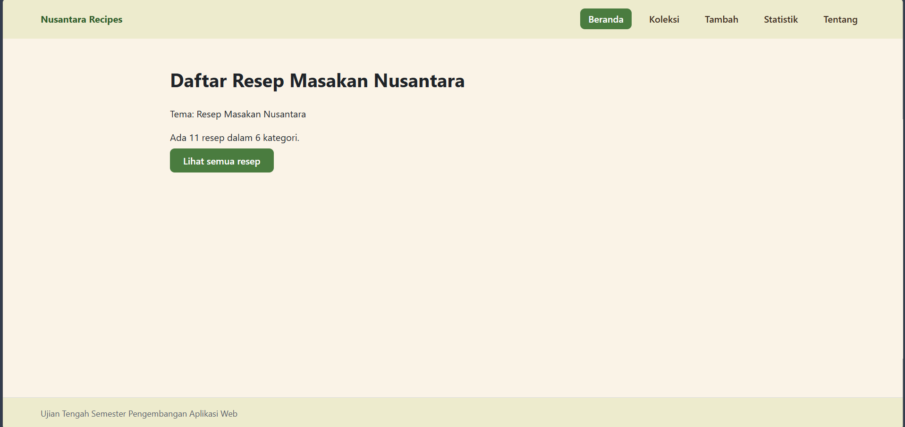

# Nusantara Recipes

- **Nama:** Abdul Aziz
- **NIM:** 124140151
- **Kelas:** RB
- **Tema:** Resep Masakan Nusantara
- **Deployment:** https://abd-16z.github.io/uts-paw/

## Fitur

- **Beranda**: menampilkan jumlah resep dan kategori yang tersedia.
- **Koleksi**: menampilkan daftar resep dalam bentuk kartu, dengan **kotak pencarian** dan **filter kategori** yang bisa dikombinasikan.
- **Detail resep**: menampilkan kategori, daerah asal, waktu masak, dan tingkat
kesulitan, dilengkapi tombol **Hapus** dengan konfirmasi.
- **Tambah resep**: formulir dengan validasi (judul minimal 3 karakter), data
tersimpan otomatis ke penyimpanan lokal.
- **Statistik**: tabel jumlah resep per kategori beserta total.
- **Tentang**: menampilkan identitas mahasiswa
- **Halaman 404**: untuk rute yang tidak dikenal.
  
## Menjalankan secara lokal

cd app
npm install
npm run dev

## Konsep React yang dipakai

- **Komponen fungsional & komposisi** — UI dibangun dari komponen kecil
(`KartuItem`, `KotakPencarian`, dst.) yang dirangkai di `App.jsx` dan `Layout.jsx`.
- **JSX** — penulisan markup deklaratif di dalam JavaScript.
- **Props** — aliran data satu arah dari induk ke anak, mis. `item` di `KartuItem`
dan `nilai`/`onUbah` di `KotakPencarian`.
- **State dengan `useState`** — pencarian, filter kategori, dan isian form Tambah.
- **Efek samping dengan `useEffect`** — memuat `data/koleksi.json` via `fetch`
saat aplikasi pertama kali dibuka (`KoleksiProvider`).
- **Context API (`createContext` + `useContext`)** — state koleksi dibagi ke banyak
halaman tanpa prop drilling melalui `KoleksiContext`.
- **Custom Hook** — `useKoleksi()` (akses context dengan pengecekan provider) dan
`useLocalStorage()` (state persisten otomatis ke `localStorage`).
- **React Router** — `Routes`/`Route` untuk multi-halaman, `NavLink` (kelas `active`
otomatis), `Outlet` untuk layout bersarang, `useParams` untuk detail, `useNavigate`
untuk redirect, serta `MemoryRouter` di test.
- **Komponen terkontrol (controlled components)** — input form dan pencarian
nilainya dikendalikan state React lewat `value` + `onChange`.
- **Render kondisional & render daftar** — `loading`/`error`/data kosong ditangani
dengan ternary; daftar dirender dengan `map()` + `key`.
- **Pengujian komponen** — Vitest + Testing Library: `render`, `screen`, `userEvent`,
stub `fetch`/`window.confirm`, dan `localStorage` untuk data uji.
